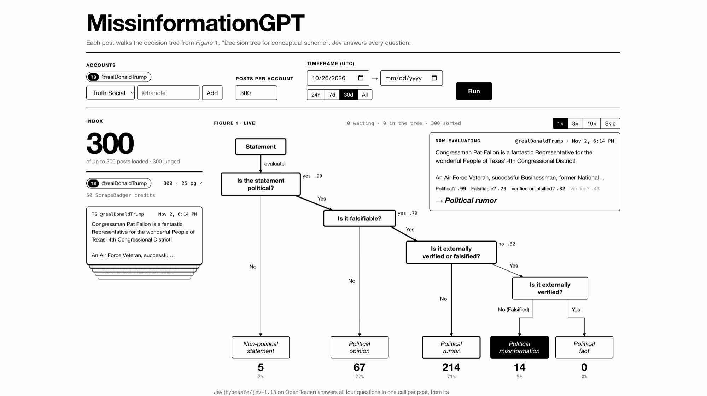

<h1 align="center">MissinformationGPT</h1>

<p align="center">
  Pull posts from Truth Social and X, and watch each one walk a misinformation decision tree.
</p>

<p align="center">
  <a href="LICENSE"></a>
  
  
</p>

<p align="center">
  
</p>

## Features

- **Any public account.** Truth Social and X, up to 10 accounts per run, 1–1000 posts each, any date range.
- **A live decision tree.** Each post travels the tree as an animated token, with the model's answer at every question.
- **Fast, cheap classification.** One call to Jev per post answers all four questions in about 0.4 s for about $0.00002, 16 posts at a time.
- **Streaming.** Posts and verdicts reach the browser as they come in, while older pages are still loading.
- **Results you can dig into.** Click a leaf to filter the table. Each row shows the four probabilities and links to the original post.
- **Small.** One Node server with no framework, a React front end, and two runtime dependencies.

## How it works

Every post is placed on this tree:

```
Statement → Is it political? ── no → Non-political statement
              └ yes → Is it falsifiable? ── no → Political opinion
                        └ yes → Externally verified or falsified? ── no → Political rumor
                                  └ yes → Externally verified? ── no → Political misinformation
                                                               └ yes → Political fact
```

| Leaf | Reached when the post is… | Example from the figure |
| - | - | - |
| Non-political statement | not political | "Today is my birthday!" |
| Political opinion | political but not falsifiable | "Voting is a waste of time!" |
| Political rumor | falsifiable, but not yet verified or falsified | "Reagan talked to Iran in 1980!" |
| Political misinformation | falsified | "Trump won the 2020 election!" |
| Political fact | verified | "Trump won the 2024 election!" |

1. **Fetch.** The server pages back through each account with [ScrapeBadger](https://scrapebadger.com). Truth Social posts come through ScrapeBadger's web scraper on Truth Social's Mastodon-style API; X posts come from ScrapeBadger's search. Reposts, replies and posts with no text are skipped.
2. **Classify.** Each post goes to **Jev** (`typesafe/jev-1.13`) through [OpenRouter](https://openrouter.ai)'s Decisions API. One call returns a probability for each of the four questions. A probability of 0.5 or more counts as "yes", and the walk stops at the first "no".
3. **Stream.** Posts, progress and verdicts go to the browser as server-sent events, and the browser animates each verdict down the tree.

## Quick start

You need **Node.js 22.18 or newer** (24 recommended), which runs the TypeScript server directly with no build step.

```sh
git clone https://github.com/cinojosa0705/MissinformationGPT.git
cd MissinformationGPT
npm install
cp .env.example .env   # then paste in your two API keys (see below)
npm run dev
```

Open http://localhost:5173. The API runs on port 8787, and Vite forwards `/api` to it.

### Getting the API keys

**ScrapeBadger** fetches the posts.

1. Sign up at [scrapebadger.com](https://scrapebadger.com/auth/signup).
2. Copy your API key from the dashboard. It starts with `sb_` ([auth docs](https://docs.scrapebadger.com/authentication.md)).
3. Make sure the account has credits.

**OpenRouter** runs Jev.

1. Sign up at [openrouter.ai](https://openrouter.ai) and add a few dollars of credit.
2. Create a key at [openrouter.ai/keys](https://openrouter.ai/keys). It starts with `sk-or-`.

### Configuration

| Variable | Required | Description |
| - | - | - |
| `SCRAPEBADGER_API_KEY` | yes | ScrapeBadger key, used to fetch posts |
| `OPENROUTER_API_KEY` | yes | OpenRouter key, used to call Jev |
| `PORT` | no | Port for `npm start` (default `8787`) |

Set them in `.env` locally, which is gitignored, or as environment variables on your host.

## Usage

1. **Accounts.** `@realDonaldTrump` on Truth Social is preset. To add another, pick *Truth Social* or *X*, type a handle and press **Add**.
2. **Posts per account.** How many posts to pull from each account (1–1000).
3. **Timeframe.** Pick dates in UTC or a preset (24h, 7d, 30d, All). Leave it empty for the latest posts.
4. Press **Run**. Posts pile up in the inbox, then travel the tree one at a time.
5. Change the animation **speed** (1×, 3×, 10× or Skip). Click a leaf to filter the results table.

### Cost

| Per 100 posts | Truth Social | X |
| - | - | - |
| ScrapeBadger credits | about 10–20 | about 105 |
| Jev on OpenRouter | about $0.002 | about $0.002 |

Verdicts are cached in memory by post, so running the same posts again doesn't call Jev again (until the server restarts).

## Deployment

### Production build

```sh
npm run build
npm start
```

One Node process serves the app and the API on http://localhost:8787.

### Share it from your machine

With `npm start` running, open a [Cloudflare quick tunnel](https://developers.cloudflare.com/cloudflare-one/connections/connect-networks/do-more-with-tunnels/trycloudflare/) (`brew install cloudflared` on macOS):

```sh
cloudflared tunnel --url http://localhost:8787
```

It prints a public `https://….trycloudflare.com` link that works for as long as the command runs.

### Host it

Any host that runs a long-lived Node server will work (Render, Railway, Fly.io or a VPS). Serverless functions such as Vercel or Netlify Functions won't, because a run streams results for minutes.

Example on [Render](https://render.com): **New → Web Service**, connect your fork, then set:

- **Runtime:** Node
- **Build command:** `npm install && npm run build`
- **Start command:** `npm start`
- **Environment:** `SCRAPEBADGER_API_KEY` and `OPENROUTER_API_KEY`

Render sets `PORT` for you and picks the Node version from `engines` in `package.json`.

> [!WARNING]
> There is no login and no rate limit. Anyone who can reach the app can start runs that spend your ScrapeBadger and OpenRouter credits.

## API

`GET /api/run` streams a run as [server-sent events](https://developer.mozilla.org/docs/Web/API/Server-sent_events).

| Query parameter | Description |
| - | - |
| `src` | `truth:<handle>` or `x:<handle>`. Repeat it for up to 10 accounts. |
| `limit` | Posts per account, 1–1000 (default 50). |
| `since`, `until` | Optional `YYYY-MM-DD` dates in UTC. `until` includes its whole day. |

| Event | Data |
| - | - |
| `post` | `{ id, source, text, createdAt, url }` |
| `verdict` | `{ id, answers: { political, falsifiable, settled, verified }, leaf }`, or `{ id, error }` |
| `progress` | `{ source, n, pages, credits, done? }` |
| `fail` | `{ source, message }` |
| `end` | `{}` |

```sh
curl -N 'http://localhost:8787/api/run?src=truth:realDonaldTrump&limit=5'
```

Closing the connection stops the scraping and classification for that run.

## Limitations

- **No live fact-checking.** Jev answers from what it already knows. It can't verify or falsify claims newer than its training, so those land in *rumor* (71% of the run in the screenshot).
- **It's one model's judgment.** For example, Jev files "Reagan talked to Iran in 1980" under *misinformation*, while the figure calls it a *rumor*.
- **A fixed 0.5 cut-off** on every question.
- **The verdict cache lives in memory** and is lost on restart.
- **Truth Social's bot protection** sometimes blocks a scrape. Running it again usually works.

## Troubleshooting

| Message | Fix |
| - | - |
| `Set SCRAPEBADGER_API_KEY and OPENROUTER_API_KEY in .env` | Add both keys (see [Configuration](#configuration)), then restart. |
| `ScrapeBadger is out of credits` | Top up your ScrapeBadger account. |
| `Truth Social blocked the scraper, try again` | Run it again. |
| `Truth Social account not found` | Check the handle (no `@` needed). |
| `No build found: run npm run build first` | Run `npm run build` before `npm start`. |
| Port 8787 is already in use | Run `PORT=9000 npm start`, or stop the other process (`npm run dev` needs 8787). |

## Project structure

```
server/
  index.ts     HTTP server: /api/run (SSE) and the built app
  sources.ts   Truth Social and X fetchers (ScrapeBadger)
  jev.ts       the four questions, Jev calls and the tree walk
  check.ts     self-checks (npm run check)
src/
  App.tsx      controls, inbox and results table
  Tree.tsx     the SVG tree and animated tokens
  types.ts     types shared by the server and the browser
```

## Contributing

Issues and pull requests are welcome. Before you open a PR, run:

```sh
npm run check   # self-checks for the tree walk and HTML cleanup
npm run lint
npm run build   # type-check and build
```

## Acknowledgements

- The decision tree is Figure 1, "Decision tree for conceptual scheme", along with its example statements.
- Posts are fetched by [ScrapeBadger](https://scrapebadger.com), and Jev runs on [OpenRouter](https://openrouter.ai).

## Disclaimer

MissinformationGPT shows how a language model reads each post. It isn't a fact-checker, and its labels are not findings about any person or account. Check primary sources before you rely on a result.

## License

[MIT](LICENSE)
